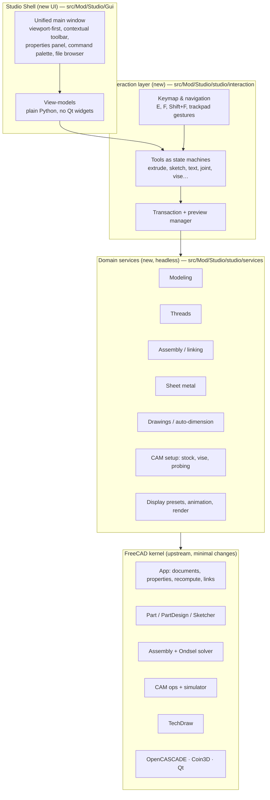

# Development Plan

How we turn FreeCAD into a fast, local, single-environment CAD/CAM app with a clean UI. The
feature gap analysis lives in the [README](../README.md#feature-roadmap); this document says
**how** and **in what order** we build it.

> Product name: **A&B CAD**, always shown with credit that it's *powered by FreeCAD* (decided
> 2026-11-14). The visible rename waits until the app clearly differs from FreeCAD (Phase 10 at the
> latest); until then it still says FreeCAD. Working codename for our code: **Studio**
> (`src/Mod/Studio`).

---

## 1. Ground rules

### 1.1 Test-driven development

Every change follows **red → green → refactor**:

1. **Red** — write a test that describes the behavior and fails for the right reason.
2. **Green** — write the smallest code that makes it pass.
3. **Refactor** — clean up with the tests still green.

A feature is **done** when:

- [ ] Domain behavior is covered by headless tests (no GUI needed).
- [ ] Interaction (tool/keyboard/mouse logic) is covered by synthetic-event tests.
- [ ] UI has at least a smoke test (it opens, binds, closes cleanly).
- [ ] Visual changes have a reviewed snapshot baseline in `tests/visual`.
- [ ] Performance budgets still pass (see §1.3).
- [ ] Existing FreeCAD tests are no worse than the recorded baseline.
- [ ] A human has used the feature in the running app.

Tests are never weakened to make them pass: no loosened tolerances, skipped cases or
regenerated snapshots without a stated reason (same rule as
[FreeCAD's testing guide](../contrib/guidelines/testing-and-validation.md)).

### 1.2 Test pyramid

| Layer | Framework | Runs with | Speed | Share |
|---|---|---|---|---|
| Domain services (Python) | `unittest` | `FreeCADCmd -t Studio` (headless) | ms | most tests |
| Core / hot paths (C++) | GoogleTest | `ctest -R Studio` | ms | where C++ is used |
| Interaction (tools, keymaps, nav) | `unittest` / GoogleTest with synthetic events | headless | ms | many |
| UI view-models | `unittest` | headless | ms | many |
| UI widgets | `QTest` smoke tests | `FreeCAD -t StudioGui` | s | few |
| Visual | snapshot baselines | `tests/visual` | s | few, key screens |
| Performance | benchmark scripts with budgets | `tools/bench` | s–min | startup, load, sim |

### 1.3 Performance budgets

"Fast and lightweight" is a requirement, so we measure it. Phase 1 records the baseline on the
reference laptop (Ryzen AI 7 445, 16 GB RAM); each later phase must stay within budget:

| Metric | Budget (set after baseline) |
|---|---|
| Cold start to usable window | ≤ **1.5 s** by end of Phase 2; **1.0 s** is the stretch goal. Checked on the **slim Release build** (what we ship): **1.41 s** on 2026-11-15, met (1.72–1.75 s on 2026-11-14, before the crash reporter's prewarm moved after startup; RelWithDebInfo builds: 1.97 s full / 1.85 s slim; their debug symbols add ~0.3 s). Measure on a quiet machine, alternating with a reference build in back-to-back batches: a single number can be off by 1 s or more ([BASELINE.md](BASELINE.md)). The earlier 2.2 s target (half the first 4.4 s measurement) was dropped on 2026-11-14 because upstream FreeCAD already meets it |
| Idle memory after start | must not grow phase-over-phase without sign-off. Slim Release: 394 MB working set / 361 MB private (2026-11-14) |
| Open reference model (STEP + native) | no slower than the baseline without sign-off, compared back to back: 0.49–0.70 s for the three native files, 1.33 s for the STEP file (2026-11-14, [BASELINE.md](BASELINE.md#reference-files-2026-11-14)) |
| Full CAM simulation of reference job | baseline (Phase 8) |

### 1.4 Staying mergeable with upstream

We want FreeCAD's kernel and bug fixes for years, so:

- **New behavior goes in our own module** (`src/Mod/Studio`), not scattered through FreeCAD files.
- **Core edits are minimal, isolated and logged** in [`docs/CORE_PATCHES.md`](CORE_PATCHES.md) (file, reason, owner).
  Prefer FreeCAD's extension points (`WorkbenchManipulator`, navigation-style registration,
  command registration, preference pages, overlays) over editing core.
- **Monthly upstream merge** on a branch, full test run, then merge to `main`
  (procedure and log: [`docs/UPSTREAM_MERGE.md`](UPSTREAM_MERGE.md)).
- License stays **LGPL-2.1-or-later**; anything ported from addons gets a license check first.

### 1.5 Decisions are written down

Architecture decisions go in `docs/adr/NNNN-title.md` (context → decision → consequences).
Phase 1 creates the first ADRs from §2.

---

## 2. System architecture

We keep FreeCAD's **kernel and document model** and replace its **presentation layer**.



### 2.1 Layers and their rules

| Layer | Owns | May depend on | Must not depend on | Tested by |
|---|---|---|---|---|
| **Kernel** (FreeCAD) | Geometry, documents, recompute, persistence, solvers | — | Studio anything | FreeCAD's own suites |
| **Domain services** | "What the user wants" as plain API: `extrude(sketch, 10 mm)`, `add_vise(job)`, `auto_dimension(view, level)` | Kernel App/Part APIs | Qt, Gui, any view | Headless unit tests |
| **Interaction** | Tool state machines, keymaps, navigation, preview and undo transactions | Services; abstract `ViewPort` / `Preview` interfaces | Concrete Qt widgets | Synthetic events |
| **View-models** | UI state: which panel, which fields, enabled/disabled, defaults | Interaction, services | Qt widgets | Headless unit tests |
| **Shell (widgets)** | Drawing the UI, binding to view-models | View-models, FreeCAD Gui | Domain logic | QTest smoke and visual |

Dependencies point **down only**. That one rule keeps almost everything testable without a
window and keeps our code separate from FreeCAD's so upstream merges stay cheap.

### 2.2 Key design choices

- **One environment.** A single always-active Studio workbench gathers the commands from Part Design,
  Sketcher, Assembly, TechDraw and CAM. Tools show up based on **selection and context**,
  not on which workbench you picked. FreeCAD's workbench switcher is hidden, not deleted.
- **Tools are modal state machines** (Blender-style operators): `start → preview → (adjust)* →
  commit | cancel`. Each tool runs inside one document transaction, so cancel and undo are always clean.
- **Python first, C++ for hot paths.** Services, tools and UI are written in Python (with PySide) for speed
  of iteration. Navigation, CAM simulation, rendering and anything profiled as slow go in C++.
- **Lazy loading.** Modules are imported the first time a tool needs them, not at startup.
- **Preferences in one place.** A typed settings service backs "right-click → Make default" on any
  field, using FreeCAD's parameter store underneath.
- **Local only.** No network calls except explicit, user-started actions (update check, part
  download). A test checks this by failing if a socket opens during the test suite.

### 2.3 Repository layout (new parts)

```
src/Mod/Studio/
  CMakeLists.txt
  Init.py / InitGui.py          # registers workbench + test suites
  TestStudioApp.py              # headless suite entry:  FreeCADCmd -t TestStudioApp
  TestStudioGui.py              # GUI suite entry:       FreeCAD -t TestStudioGui
  branding/branding.xml         # product config (start workbench, name, nav style…), copied to bin/
  studio/
    services/                   # headless domain services
      settings.py               # typed preferences + "make default" (a service, so the layer test covers it)
    interaction/                # tools, keymap, navigation, transactions
    viewmodels/                 # UI state, no widgets
  Gui/                          # Qt widgets, resources, icons, .ui files
  App/                          # C++ (only when needed)
  StudioTests/                  # FreeCAD convention <Module>Tests (a bare "tests" package would clash)
    support.py                  # shared helpers, e.g. no_network() guard
    test_architecture.py        # enforces the layer rules automatically
    gui/                        # tests that need FreeCAD.exe
tests/src/Mod/Studio/           # GoogleTest suites for C++ parts
tools/bench/                    # performance benchmarks + budgets
docs/
  PLAN.md  CORE_PATCHES.md  adr/
```

---

## 3. Phases

Each phase ends with a working app, green tests, and budgets checked. Phases 3–9 can be
reordered by priority; Phases 1–2 come first because everything else sits on top of them.

### Phase 1 — Foundation *(done 2026-11-14)*

**Goal:** build FreeCAD from source on this PC with one command, record a baseline, and scaffold
our module with TDD and CI in place.

| # | Task | Done when |
|---|---|---|
| 1.1 ✅ | Install toolchain: Visual Studio 2022 Build Tools (C++), pixi; init submodules (see [ADR 0003](adr/0003-native-windows-dev-environment.md)) | `pixi run configure` succeeds |
| 1.2 ✅ | Baseline build (RelWithDebInfo, parallelism capped for 16 GB RAM) | FreeCAD launches from our build |
| 1.3 ✅ | Baseline tests: run `ctest` and the headless suites, record results in [`docs/BASELINE.md`](BASELINE.md). Added `tools/test/run_headless_suites.py` (isolated profile, per-test watchdog) | Known upstream failures listed, so they're never mistaken for ours |
| 1.4 ✅ | Benchmark harness in `tools/bench`: cold start ✅, idle memory ✅, open reference files ✅ (`bench_open.py`: 3 native files + 1 STEP, rejects incomplete loads; CI checks the files open completely) | Baseline numbers recorded; budgets set in §1.3 |
| 1.5 ✅ | **Slim build** preset: turn off FEM, BIM, Robot, OpenSCAD, Points, ReverseEngineering, Inspection, Web, JtReader, AddonManager (verify dependencies one module at a time). `pixi run configure-slim` / `build-slim` → `build/slim` ([ADR 0006](adr/0006-slim-build.md)): all kept suites pass, 0 tests worse; startup −6% on a quiet machine (1.97 → 1.85 s), memory −2–3% | Slim build launches, tests no worse than baseline, startup and memory measured |
| 1.6 ✅ | Scaffold `src/Mod/Studio` (layout from §2.3), registered with CMake and the test runner | `FreeCADCmd -t TestStudioApp` runs a real (initially failing → passing) test |
| 1.7 ✅ | **Walking skeleton (TDD):** Studio workbench exists, is the default at startup (via [branding.xml](adr/0004-branding-via-branding-xml.md)), shows an empty shell; layer-rule tests; local-only socket guard test; end-to-end `tools/test/startup_smoke.py` | Tests written first; all green |
| 1.8 ✅ | CI for our fork: replace upstream's heavy workflows (they trigger on our pushes) with a lean Windows build + Studio tests; full suite nightly or on demand. Upstream workflows + Dependabot removed, `studio-ci.yml` + `tools/repo_tests` added ([ADR 0005](adr/0005-own-ci-workflow.md)). First run green on `main` 2026-11-13 (cold build, no compiler cache: 2 h 9 min) | CI green on `main` |
| 1.9 ✅ | Repo docs: our own `AGENTS.md`/`CLAUDE.md` (TDD rules, layers, upstream rules) ✅, ADR template + first ADRs ✅, `CORE_PATCHES.md` ✅, upstream-merge procedure ✅ ([`UPSTREAM_MERGE.md`](UPSTREAM_MERGE.md); first merge 2026-11-14: 19 commits, no conflicts, 0 tests worse) | Docs merged; a practice upstream merge has been done once |

**Exit:** one-command build, baseline and budgets recorded, Studio module green in CI.

### Phase 2 — The Shell (clean, unified UI) ✅ *(done 2026-11-15)*

**Goal:** the app *feels* different: sparse, viewport-first, one environment, laptop-friendly.

Foundations come first, then the visible changes built on them (order agreed 2026-11-14).

| # | Task | Done when |
|---|---|---|
| 2.1 ✅ | **Startup profiler ✅ + lazy-loading design ✅.** A tool showing where startup time goes (C++ init, Python imports, each module's `Init.py`/`InitGui.py`, first workbench activation). FreeCAD runs its embedded Python in isolated mode, so `PYTHON*` variables such as `PYTHONPROFILEIMPORTTIME` are ignored and the hook has to live inside the app. ADR: how the single environment offers every module's tools without loading those modules at startup ([ADR 0007](adr/0007-lazy-loading-command-catalog.md), accepted: generated command catalog, load on first use, warm-up for cheap modules; CAM alone would add ~0.6 s to startup) | Profile recorded in `BASELINE.md` ✅; ADR accepted ✅ |
| 2.2 ✅ | **Settings service** (`studio/services/settings.py`): typed preferences on FreeCAD's parameter store, defaults, "Make default" (= store the field's value as the user's default; the right-click menu itself comes with the fields in 2.6). 21 headless tests: types, 32-bit and finite checks, choices, values left over from older versions, reset | Headless tests green |
| 2.3 ✅ | **Command catalog** ([ADR 0007](adr/0007-lazy-loading-command-catalog.md)): generator + catalog of 719 commands ✅ (`tools/studio/generate_command_catalog.py`, CI checks it matches the build); command service ✅ (`studio/services/commands.py`: loads a command's workbench on first use, through a `CommandBackend` the shell implements); shell backend ✅ (`studio/shell/backend.py`) + C++ helper `StudioGui.initialize_workbench` ✅ (loads a workbench's commands without switching to it, C++ and Python workbenches alike; a later switch doesn't initialize it again); warm-up ✅ (`studio/shell/warmup.py`, setting `Commands/WarmUp`: 1 s after Studio activates, one cheap workbench per 50 ms tick, never CAM, pauses while a mouse button is held); `startup_smoke.py` checks startup loads no catalog workbench (warm-up off) and that warm-up loads its plan (default settings). Startup cost of the wiring: ≤ ~25 ms, within noise. The catalog service: every command's name, icon, module and the context it applies to, readable *without* importing the module; commands load on first use | Headless tests green; startup not slower |
| 2.4 ✅ | **Keymap service** (design: [ADR 0008](adr/0008-keymap-contexts.md), accepted: Studio owns the shortcuts, which depend on context such as sketching vs. global). Keymap logic ✅ (`studio/interaction/keymap.py`: key-sequence normalizing, contexts, user bindings via settings, conflicts incl. prefix clashes; with FreeCAD's defaults: 76 Global and 77 Sketcher bindings, 15 conflicts inside FreeCAD's own defaults, reported); shortcuts in the app ✅ (`studio/shell/shortcuts.py` + C++ key filter `StudioGui.add_key_filter`: claims the active keymap's keys, never in text fields or dialogs; sketch/assembly editing switches context; keys of inactive commands go to the widget, so Esc still cancels; no measurable cost per event or at startup). Tried by the user in the running app 2026-11-14: E, F, Shift+F, sketch keys and Esc all work: `E` extrude, `F` focus selection, `Shift+F` fit all, user-editable bindings, conflict detection | Headless resolution tests; shortcuts work in the app |
| 2.5 ✅ | **Command palette**: search every command by name. Opened with `S` (outside sketches, like Fusion 360) and `Ctrl+K` (everywhere), chosen by the user 2026-11-14. Search logic ✅ (`studio/viewmodels/palette.py`: 680 entries, ~2 ms per search, ranks title start > word start > substring > category/name > tooltip > letters in order; shows active shortcuts; recently used first); palette window ✅ (`studio/shell/palette.py`, command `Studio_CommandPalette`: type to filter, Up/Down, Enter runs, Esc closes; icons of not-yet-loaded tools shipped with Studio, 552 SVGs / 0.7 MB). Tried by the user in the running app 2026-11-14: S, Ctrl+K, search, Enter, Esc and icons all work | Ranking tests (headless); QTest smoke |
| 2.6 ✅ | **Unified main window** ([ADR 0009](adr/0009-unified-main-window.md), layout A chosen by the user from mockups): workbench switcher hidden, one ☰ menu, toolbar on top that follows the selection (icon + label, plain tool names), tree above properties in one collapsible panel, status-bar hint. "Make default" on fields moved to Phase 3 (Studio's own tool panels). Toolbar logic ✅ (`studio/viewmodels/context_toolbar.py`: 7 kinds of selection, tools per kind, hints; `tool_names.py`: Extrude/Cut/Shell…, also used by the palette); window ✅ (`studio/shell/window.py`: ☰ menu, panel button, Search button, toolbar following the selection, status hint; FreeCAD's 9 toolbars and extra menus removed; startup not slower); editing a sketch stays in Studio (`studio/shell/environment.py`). Tried by the user 2026-11-14: "everything else looks clean"; sketching left Studio, fixed and confirmed ("it works now") | View-model tests; QTest smoke; tried in the app |
| 2.7 ⏸ | ~~**Navigation style** (new default): trackpad pinch zoom and two-finger orbit, plus mouse~~. **Deferred** (2026-11-14, the user's call): they work with a mouse and dislike trackpad navigation; it may come back later as a backup for when no mouse is at hand. FreeCAD's own Touchpad and Gesture navigation styles remain available meanwhile | Not part of Phase 2's exit |
| 2.8 ✅ | **File browser** replacing the Start page: recent files with thumbnails; remove or hide entries. A Home page fills the main area whenever no document is open (New Part, Open, recent-file cards). Data ✅ (`studio/services/recent_files.py` on FreeCAD's own list, so File > Recent Files agrees; `thumbnails.py` reads the preview stored in .FCStd files; `viewmodels/home.py`: cards with "Saved 2 hours ago"); page ✅ (`studio/shell/home.py`: covers the main area while no document is open, previews load after it appears, right-click → Remove from list; FreeCAD's Start page switched off: startup ~60 ms faster). First human try: everything worked except a file listed twice showing as two cards and FreeCAD's 4-file list dropping cards; fixed (a file shows once however it is spelled; Studio raises the list to 12 files once per profile, Preferences > General can still change it). Second try 2026-11-14: confirmed fixed | Recent-files store tests; QTest smoke; tried in the app |
| 2.9 ✅ | **Look and feel** (added 2026-11-14 at the user's request: "as soon as 2.8 is finished let's focus on the looks"). The app still wears FreeCAD's look; give it its own: colours (light/dark), Studio's top bar, toolbar, panel and Home page styling, icons for the tools Studio shows, the 3D view's background and highlight colours. Options shown as mockups ([look options page](https://claude.ai/artifact/7Wp13RLjg18JhJSmffhSBj)); the user picked light and dark following Windows, teal accent in light and orange in dark, Studio line icons, soft-gradient 3D background ([ADR 0010](adr/0010-studio-look.md), accepted: Qt's Fusion style with Studio's palette, not FreeCAD's 2,800-line stylesheet, which costs ~190 ms at startup). Steps: theme service ✅ (`studio/services/theme.py`: light and dark palettes, mode, FreeCAD's 3D and sketch colors written without overwriting the user's; contrast checked by tests); in the app ✅ (`studio/shell/appearance.py`: Fusion picked before the GUI starts, Studio's palette, 3D, sketch and tree colors, follows Windows live, ☰ › Appearance: Follow Windows, Light, Dark; Studio's call ~3 ms); Studio's styling ✅ (bars, search field, Home with an accent New Part button, tiles in the mode's colors and no empty Model panel; FreeCAD's property group rows, flat property area, title buttons, status text; the session look followed live); line icons ✅ (48 drawings: Studio's toolbar and palette in the text color, FreeCAD's model tree, menus and eye icons in a neutral grey under FreeCAD's own icon names; ~10 ms at startup); startup ✅ (the look costs ~21.5 ms inside the app, under its 30 ms; end to end the busy machine's noise was larger than that, re-checked on a quiet machine in 2.10); tried by the user ✅ ("it looks amazing", "everything looks clean"). Left for later: FreeCAD's floating Tasks panel is still an empty box over the 3D view between tasks (every fix tried crashed FreeCAD on a workbench change, `docs/BASELINE.md`; needs a native stack trace) | ADR accepted ✅; look applied to the main screens; startup not slower (≤ 30 ms); tried by the user |
| 2.10 ✅ | **Visual baselines** of the main screens in the new look (`tests/visual`); startup checked against the budget (≤ 1.5 s, stretch 1.0 s). Baselines ✅ captured: Home, a model with a face selected and a sketch being edited, light and dark (`tools/test/run_visual.py`, pictures in `tests/visual/baselines/studio`, 3D view masked except the Tasks panel over it, vendored font); in CI ✅ (GitHub's runner has no graphics card: Qt's Mesa software OpenGL goes next to FreeCAD.exe; the window has a fixed size so it can be bigger than the runner's 1024 × 768 screen; text and sizes pinned at 96 DPI, since this machine's display is at 125 %). On the runner they also caught a Windows 11-only look bug: FreeCAD built its window in Qt's "windows11" style before switching to Fusion, which left the model tree and properties on the bars' grey; Qt now starts in Fusion ([ADR 0010](adr/0010-studio-look.md)), and the baselines were retaken at 96 DPI with the lists on white; they caught Home's toolbar keeping FreeCAD's icons at startup (fixed). The user's review: FreeCAD's colorful constraint icons in the sketch's Tasks panel stood out → line icons for every Sketcher constraint ✅. Startup ✅ **1.41 s** on the slim Release (was 1.67–1.74 s): with the user's approval, the crash reporter's prewarm (~266 ms) runs on a thread 5 s after startup ([CORE_PATCHES.md](CORE_PATCHES.md)); moving FreeCAD's OpenGL check later was measured and not kept (no change). The 1.0 s stretch goal stays open | Baselines reviewed ✅; budget met ✅ |

**Exit:** a user can work in one environment without switching workbenches, find any command
from the palette or keyboard, and start the app within the startup budget.

### Phase 3 — Modeling UX *(closed 2026-11-27, started 2026-11-17)*

**Goal:** making a part is quick and obvious: sketch the way Fusion does, pull it into 3D, look at it
the way you need.

Sketching comes first (moved in at the user's request, 2026-11-17: "auto dimensioning and auto
constraints, like how Fusion would operate"). FreeCAD's sketcher already has part of it: while drawing,
boxes show sizes and a typed value becomes a dimension ("on-view parameters"), and it adds horizontal,
vertical, coincident, midpoint, tangent, parallel and perpendicular constraints as you draw. What it
lacks is a one-click way to finish defining a sketch (Fusion's AutoConstrain).

**Test project:** a yarn holder (spindle stand: a round base with an upright peg) the user is making for
a friend, modeled by the user from start to finish after 3.5, in inches: sketches with sizes, extrude, a sketch on a
face, rounded edges. Whatever gets in the way becomes a fix in this phase.

| # | Task | Done when |
|---|---|---|
| 3.1 | **Inches or millimeters** (added 2026-11-17: the user works in inches; [ADR 0011](adr/0011-units.md)). ☰ › Units: Follow Windows (its region's measurement system: US → inches), Inches, Millimeters. The choice applies everywhere, also to files saved in other units (FreeCAD otherwise shows each file in its own), and sizes are typed and shown in it ("2.50 in", FreeCAD's "Imperial decimal"). Built ✅: units service (11 tests), ☰ › Units, files saved in millimeters open and stay in inches without being marked changed (7 tests in the app); visual baselines taken in inches. Waiting: tried by the user | Units service tests (choice, Windows' system, FreeCAD's unit settings); the menu and a switch tested in the app; tried by the user |
| 3.2 | **Type sizes while drawing.** Check FreeCAD's on-view parameters in Studio's sketch tools (line, rectangle, circle, arc): the size boxes show, Tab moves between them, a typed value becomes a dimension, in Studio's look; fix the defaults where they differ from Fusion. Checked ✅ with synthetic input in the app (7 tests): line (length, angle), rectangle (width, height), circle (diameter, as Fusion asks), arc (radius, sweep) give the typed dimensions, in inches; a size typed with a unit ("50 mm", "0.5 ft") is converted; Studio's letter shortcuts (E, F, S) type into the box. Fixed ✅: typing replaced only the number and kept the unit after it, so "50 mm" became "50 mm in", read as 50 in; now the first key replaces the whole box (`StudioGui.install_size_box_typing`, `studio/shell/sketching.py`). Left as FreeCAD has it: dimension labels show up to 6 significant digits ("2 in", but "0.23622 in" for a 6 mm size). Waiting: tried by the user | Each sketch tool, tested with synthetic input: typed sizes give the matching dimensions; tried by the user |
| 3.3 | **Smart auto constraints.** Compare FreeCAD's constraints-while-drawing with Fusion's (horizontal/vertical, coincident, midpoint, tangent, parallel, perpendicular, equal, concentric) and set Studio's defaults: on, no redundant ones. Checked ✅ with synthetic drawing in the app (11 tests): horizontal and vertical (within 2°), joined ends, a line's midpoint, a point on a line or a circle, concentric circles, parallel and perpendicular to the line being continued, the same in inches and millimeters; slanted lines get nothing. FreeCAD's defaults already match (on; redundant ones avoided), so nothing changed. Decisions on the rest: *equal* not inferred (Fusion doesn't either: it is a choice, not something a drawing shows); *tangent* lines and arcs come from FreeCAD's polyline tool and arc modes, not tested yet; parallel or perpendicular to a line hovered over (not continued from) is FreeCAD's hover hint, not tested. Waiting: tried by the user | The tools' constraints, tested on drawn shapes; the missing ones listed with a decision each; tried by the user |
| 3.4 | **One-click Fully Constrain** (new). A sketch tool that adds every missing constraint and dimension so the sketch is fully defined (it turns green) without moving anything; one undo step removes them all. A headless service (`auto_constrain(sketch)`) chooses what to add: shapes' own constraints first, then sizes, then positions from the origin. Built ✅: `studio/services/auto_constrain.py` (22 tests: rectangles at and away from the origin, circles, arcs, a slanted triangle, a turned rectangle keeping square corners, a slot keeping its tangent ends, points on lines, construction lines, the user's constraints kept, one undo, a sketch with conflicts left alone); the sketch toolbar's **Fully Constrain** (padlock) with a status-bar summary (3 tests in the app). Only constraints the drawing already satisfies are offered and the solver keeps each only if nothing is redundant or moves, so it never changes the shape. Time: a few shapes take hundredths of a second. **Made fast** ✅ 2026-11-21 (the user found it slow on big sketches): each try solved the whole sketch, and in the app also redrew it, so 80 lines took 7.4 s headless and 43 s in the app. Now each shape is tried alone on a scratch sketch in a temporary hidden document and what it keeps is added at once; points are tested against curves through precomputed reaches and a sweep, not every pair. 80 lines: 0.35 s headless, 0.6 s in the app; 200 lines 1.3 s; the same constraints as before. One connected shape still solves whole on each try (a 40-sided outline: 1 s). A shape tied to outside geometry is tried in the sketch as before (3 more tests: two timings, outside geometry). Ellipses and splines aren't sized (reported). Waiting: tried by the user | Service tests: sketches of lines, rectangles, circles, arcs and slots end fully defined, every point where it was, nothing redundant or conflicting; tried by the user |
| 3.5 | **Extrude by dragging:** sketch → `E` → drag the arrow (or type the distance) to extrude, into the part to cut (wrapping Part Design's Pad and Pocket). So far ✅: E on a selected sketch opens Part Design's Pad with a live preview, FreeCAD's drag arrow and the length's number selected; a length typed in inches or with a unit is taken (fixed: "20 mm" became "20 mm in", which Return ignored, the trap from 3.2, now fixed for every size box), Return finishes (2 tests, in their own GUI suite `TestStudioModelingGui`: they load Part Design, which TestStudioGui needs not loaded). Tried by the user 2026-11-18 ("I'm loving it, it's easier to use than normal FreeCAD"). Fixed ✅: E took a maximized window out of maximized: Part Design's panels ask for its workbench and Studio came straight back; now a switch asked for from Python loads the workbench's commands and stays in Studio ([ADR 0009](adr/0009-unified-main-window.md) amended; 1 test, also faster). Built 2026-11-20 ✅ (the user's pick: cut by direction, like Fusion): **dragged into the part, an extrude becomes a cut; a cut dragged out of it, an extrude** (`studio/services/extrude.py`, 22 headless tests: when to switch — into material, turned around, nothing behind it, from inside the part, only the body's last feature with a plain length — and the cut taking the extrude's place with the same tool, also in a moved body, in one undo step; `studio/shell/extrude_direction.py`, 7 tests in the app). Letting go of the arrow pointing the other way switches straight away: Studio presses the panel's OK, undoes that step and starts the other tool on the same sketch with the same length, so the cut's own panel shows the result and its Cancel leaves nothing (FreeCAD's `resetEdit` commits a panel's transaction, so the feature can't be swapped with its panel open). A typed length, Finish or an edited feature ending the other way is redone as the other feature in one undo step. The **arrow in the accent color** ✅ (FreeCAD's style tokens `LinearGizmoBaseColor`… in the user's layer, `Themes/UserParameters`; reloaded on a light/dark switch, `StudioGui.reload_style_tokens`). **Finish and Cancel on the toolbar** while a panel is open ✅ (Extrude, Fillet, Measure…: the "task" kind, commands `Studio_Finish`, `Studio_Cancel` pressing the panel's own buttons; 3 tests in the app). Waiting: tried by the user | Extrude tool's states tested (start, preview, commit, cancel, undo); tried by the user |
| 3.6 | Right-click → **Make default** on the tools' fields (moved here from 2.6, [ADR 0009](adr/0009-unified-main-window.md)), stored through the settings service. Built ✅ 2026-11-20: right-clicking a size box in a Part Design feature's panel (Extrude's length, Fillet's radius, Hole's diameter…) offers **Make Default**, and **Forget Default** once one is made; a new feature of that type then starts with it (Part Design's Extrude otherwise starts at a fixed 10 mm), an existing one edited keeps its values. `studio/services/field_defaults.py` (9 headless tests: per feature type and field, in the box's unit's base, kept across sessions), `studio/shell/field_defaults.py` and `StudioGui.add_field_menu` (FreeCAD's `PrefQuantitySpinBox` builds its menu with no way to add to it, so Studio shows it: the recent values, Save Value and Edit stay; FreeCAD's Clear List is left out); 4 tests in the app. Waiting: tried by the user | Settings service tests; tried by the user |
| 3.7 | One-click **section view** with a draggable plane. Built ✅ 2026-11-20: **Section** on the toolbar (nothing selected, or a face) cuts the 3D view: on the flat face picked, keeping the part behind it, or through the middle of the model on the front, side or top plane nearest the view (exactly along the view the arrow would point at the viewer, a dot that can't be dragged); Extrude's arrow, in the accent color, drags it; it is a switch, lit while on. Only the view is cut, as FreeCAD's clipping plane does: the cut faces aren't filled in. `studio/services/section.py` (8 headless tests), `studio/shell/section.py`, command `Studio_Section`, `StudioGui.section` (FreeCAD's `toggleClippingPlane` and its `SoLinearDraggerContainer`); 5 tests in the app; looked at on the example model; visual baselines retaken (the new button). Waiting: tried by the user | Tested; tried by the user |
| 3.8 | **Display presets:** pretty (shadows), gray box, realistic, hidden line; perspective/ortho toggle. Built ✅ 2026-11-20, what FreeCAD's renderer draws: a **Display** menu on the top bar with Shaded with Edges (FreeCAD's As Is), Shaded, Hidden Line, Wireframe and a Perspective switch, remembered and applied to every document's views, also ones opened later (`studio/services/display.py`, 4 headless tests; `studio/shell/display.py`; `StudioGui.draw_style` reads the view's style back; 4 tests in the app; visual baselines retaken). **Pretty**, **Gray Box** and **Realistic** ✅ 2026-11-21 (the user said yes to the rendering work; [ADR 0012](adr/0012-display-looks.md)): FreeCAD draws no shadows; Coin, which it draws with, has them (`SoShadowGroup`, never used by FreeCAD). `StudioGui.set_look` moves each view's object group into a shadow group with a light from above and a floor under the model, in the 3D background's color, that takes the shadow and follows the model; no FreeCAD code changed. Pretty: shaded with edges + shadows; Gray Box: every part one gray, no edges, shadows; Realistic: the parts' own colors with highlights, no edges, shadows. On the Display menu after the draw styles (`studio/services/display.py`: each style a draw style and a look, the old setting values kept; 4 more headless tests); 7 tests in the app (each look, taken off again, the floor under the model and following it, the model still picked, a document opened later). The 3D view is masked in the visual check, so the presets were reviewed on screenshots (the example model and colored parts, light and dark). Shadow edges are a little stepped (Coin's smoothing is switched off in Coin). Waiting: tried by the user | Tested; visual baselines for each preset |
| 3.9 | **Threads:** cosmetic by default, "model all threads on export", **allowance scrubber** (works on cosmetic and modeled), one-click hole chamfer. **One-click hole chamfer** ✅ 2026-11-20: a hole picked in the model tree offers **Chamfer Hole**; it runs Part Design's Chamfer on the hole's openings (its own edge, or its counterbore's or countersink's; not where a through hole comes out), sized a tenth of the diameter (at least 0.2 mm) unless the user made Chamfer's size their default; Finish keeps it, Cancel takes it away (`studio/services/holes.py`, 6 headless tests; `studio/shell/holes.py`, command `Studio_HoleChamfer`; 3 tests in the app). FreeCAD already makes threads cosmetic by default (`ModelThread` off). **Model all threads on export** ✅ 2026-11-20: File › Export (also Ctrl+E and the palette) gives the exported file modeled threads while the model keeps them cosmetic, with no undo step left (`studio/services/threads.py`, 5 headless tests including a STEP export; `studio/shell/export_threads.py` wraps the export functions of FreeCAD's exporting modules, ImportGui, Import and Mesh, when they are first imported; ☰ › Threads › Model Threads on Export, on by default; 3 tests in the app, STEP and STL). **Allowance scrubber** ✅ 2026-11-21 (the user approved the design): a threaded hole picked in the model tree shows **Fit** on the toolbar, how much bigger (+) or smaller (−) the hole is made than standard for 3D-printed parts; scrolling over it (no click needed) or Up and Down step it by 0.002 in or 0.05 mm, up to ±0.08 in / ±2 mm, and the hole follows straight away; a fit can be typed, also with a unit; a run of scrolls is one undo step. It is FreeCAD's custom thread clearance, which FreeCAD applied only to modeled threads: now it also widens a cosmetic thread's drilled hole (CORE_PATCHES.md), so an export, which models the threads, keeps the fit (`studio/services/threads.py` `fit`, `set_fit`, 7 headless tests; `studio/viewmodels/thread_fit.py`, 13 tests; `studio/shell/thread_fit.py`, a text field that steps on the wheel itself since FreeCAD's `WheelEventFilter` swallows wheel events on spin boxes without the keyboard focus; the toolbar takes widgets for a kind of selection, `StudioWindow.add_tool_widget`; 7 tests in the app). Waiting: tried by the user | Thread service tests (cosmetic ↔ modeled volume checks, allowance changes diameter); export-with-modeled-threads round trip |
| 3.10 | **Tasks panel medium-sized** (the user, 2026-11-18: "on the right side, but not really tall and skinny: medium, and slightly wider"). The panel floats under the navigation cube, 420 px wide (FreeCAD: 352) and about two thirds as tall as the room there (at least 360 px), following the window and the documents' tab bar. Built ✅: `studio/services/tasks_panel.py` (8 tests), `studio/shell/tasks_panel.py` through FreeCAD's floating-panel settings (`OverlayRight`: `Width`, `Offset2`), written only when they change since FreeCAD lays the panels out again on each write; the width is Studio's once, then the user's (2 tests in the app); visual baselines retaken. **No empty box between tasks** ✅ 2026-11-21 (open since 2.9): FreeCAD's panel is see-through by default and its "Auto task" mode, the right panel's default, hides it only when it isn't; see-through needs FreeCAD's stylesheet, which Studio doesn't load, so the empty panel was a white box over the model. Studio makes it solid (`FreeCADTasksPanel.make_solid`, 2 tests) and it shows only while a task is open. FreeCAD never hides a panel holding the keyboard focus, and after a task the focus stayed on the empty task view: `StudioGui.follow_tasks` gives it back to the 3D view and has FreeCAD check its panels again. Fields in the panel count while it slides in (`set_field`, `focus_field`: Chamfer Hole's size was lost otherwise). 2 tests in the app; visual baselines retaken. Making it solid crashed FreeCAD on a workbench change on 2026-11-15 (docs/BASELINE.md); not seen again in 3 full GUI runs and 16 runs of the workbench tests. Waiting: tried by the user | Size rules tested; the panel measured in the app, also after the window shrinks; tried by the user |
| 3.11 | **Fillet and Chamfer pick edges straight away** (the user, 2026-11-18: "the ability to select new geometry needs to be turned on by default"). FreeCAD opens them picking only when no edge was selected first; with one selected (Studio's toolbar offers Fillet for a selected edge) its "Select" button had to be pressed first. Built ✅: `studio/shell/feature_panels.py` presses it when the panel opens (`StudioGui.start_picking`); a click adds an edge, a second click takes it out (3 tests in the app). FreeCAD still stops picking when a size is typed, to show the result; "Select" picks again. Waiting: tried by the user | Picking tested in the app for Fillet and Chamfer; tried by the user |
| 3.12 | **More ways to draw each shape** (the user, 2026-11-18: "the rectangle only has one selection, the classic corners pull… center rectangle and other options, like Fusion and Inventor; other geometry tools should have options as well: look at AutoCAD's, Fusion's and Inventor's sketch tools"). Compare the three with FreeCAD's sketcher, show every way to draw a shape on Studio's toolbar (a drop-down under each tool, as Fusion does) and build what's missing. Compared ✅ ([SKETCH_TOOLS.md](SKETCH_TOOLS.md)): FreeCAD already has most ways, Studio's toolbar showed one per shape. Built ✅: the sketch toolbar has Line, Rectangle, Circle, Arc, Polygon, Slot, Spline, Ellipse, Point and Text; each tool with several ways has an arrow listing them (Rectangle: 2-Point, Center, 3-Point, 3-Point Center, Rounded) and draws the way picked last, remembered; ways FreeCAD has no command for start its tool in that method (`StudioGui.set_drawing_method`); a line icon for each way (`studio/viewmodels/context_toolbar.py` `WAYS`, 9 tests; 5 tests in the app drawing a center, a 3-point rectangle and a 3-point circle); visual baselines retaken. Missing ways need FreeCAD's Sketcher edited (its tool panel class isn't exported, so Studio can't add tools with size boxes); the user said go on 2026-11-19 and asked for a center-point line too. Added ✅ to FreeCAD's tools (CORE_PATCHES.md): Center Point Line, 2-Point, 2-Tangent and 3-Tangent circles, Tangent Arc, Circumscribed and Edge polygons, Overall and Center Point slots, each on Studio's drop-downs (16 tests in the app drawing each by clicks and typed sizes; FreeCAD's Sketcher suites pass); the Three Point Arc Slot ✅ 2026-11-20 (2 more tests). Every way in the comparison is on the toolbar now. Waiting: tried by the user | The comparison written down; each way to draw tested with synthetic input; tried by the user |
| 3.13 | **Construction on and off** (the user, 2026-11-19: "a way to activate construction geometry"). A Construction switch on the sketch toolbar and X, as in Fusion: with sketch geometry selected it turns that geometry into construction and back; with nothing selected it switches what gets drawn next, also in the middle of a shape (FreeCAD passes letter keys from the size boxes to the 3D view until a number is typed), and the button stays lit while it's on. Built ✅: `Studio_Construction`, a C++ command in `StudioGui` running FreeCAD's Sketcher_ToggleConstruction; it is C++ because Python can't hear when construction goes on or off, and FreeCAD tells the commands registered for its "ToggleConstruction" mode (`StudioGui.construction_mode`, `watch_construction`); X in the sketch keymap; a switch state in the toolbar view-model (4 tests); 4 tests in the app (the button, X before and in the middle of a line, X on selected lines); visual baselines retaken. Waiting: tried by the user | Tested in the app with synthetic input; tried by the user |
| 3.14 | **Patterns in sketches and in the model** (the user, 2026-11-19: "patterns, both in sketches and regular modeling"). One Pattern button with Fusion's Rectangular Pattern, Circular Pattern and Mirror: in the model (Part Design's Linear Pattern — two directions —, Polar Pattern and Mirrored; on the toolbar with nothing selected, patterning the whole part, and with a feature picked in the tree, that feature) and in sketches (FreeCAD's Move / Array, Rotate / Polar and Mirror tools). Built ✅: `context_toolbar` `WAYS` for both, `NEEDS_SELECTION` (the sketch's patterns work on geometry selected first, so the button waits for a selection instead of FreeCAD's warning dialog), `Way.settings` (they start with three elements, as Fusion's; `StudioGui.set_tool_parameter`); 4 tests in the app for sketches, 3 for the model; visual baselines retaken. Waiting: tried by the user | Tested in the app; tried by the user |
| 3.15 | **More snaps while sketching** (the user, 2026-11-19: "snaps would be much appreciated to help placing geometry on pre-existing geometry"; chose all four): intersections of two curves, circle and arc quadrants, a center offered from hovering the circle's edge, an easier snap to the middle of a line or arc. FreeCAD already snaps to ends, centers, along curves and to middles within 5 % of them. Built ✅ in FreeCAD's sketcher snapping (approved by the user; CORE_PATCHES.md): within about 12 pixels of the pointer on a curve, the nearest crossing, quadrant or lately hovered center; such centers also from about 24 pixels with nothing under the pointer; middles from the snap distance or 10 %. A snapped point keeps to every curve it lies on (two point-on-curve constraints where curves cross) and to a center (coincident). 5 tests in the app (red with FreeCAD's snapping). Waiting: tried by the user | Tested in the app with synthetic input; tried by the user |
| 3.20 | **Threads on a shaft** (the user, 2026-11-26: "is adding threads to a cylinder an option in one of the tabs"; picked "like Fusion", [ADR 0014](adr/0014-thread-on-a-shaft.md)). Built ✅ 2026-11-26: pick a round face, **Thread** (on the toolbar for a face, and under Create): a Thread feature in the body, its size the standard one nearest the face's diameter (inches: UNC first, then any within 2 %; from FreeCAD's own thread tables), its panel open: standard, size, Modeled, full length or a length from the face's end, from the other end, left handed, Fit. Cosmetic by default: the solid stays, the face shows FreeCAD's thread texture (as a cosmetic hole thread). Modeled cuts the ISO/Unified groove along a helix, kept within the face (no cut into a shoulder). An export models it; the toolbar's Fit box works on it (+ looser: the shaft that much smaller across). `studio/services/shaft_threads.py` (headless tests), `studio/shell/shaft_threads.py` (tests in the app). Inside faces keep the Hole tool's threads. Fixed 2026-11-26 after the user's first try (an exported stem came out smooth): the groove's sweep (one long approximated helix) silently cut nothing, or failed, for 325 of 660 size and length cases; it now uses FreeCAD's long helix, as the Hole tool does (0 of 660). The thread is its size's: a face thicker than that is turned down to it along the thread (the user's 0.56 in stem threaded 1/2-13 gets a 1/2 in thread). A cut that takes nothing is an error, and an export that has a thread plain says which: also when a feature after it fails once it is modeled (a chamfer on a threaded hole's edge loses its edge) or it waits on a body that failed (the sunflower's stem is drawn on the flower's hole). A hole's thread texture comes back after an export also with a panel open. Waiting: tried by the user | A round face threaded cosmetic or modeled, sized from the face, with a fit; exported modeled; tried by the user |
| 3.18 | **Plain names in the model tree, holes in your units' threads** (the user, 2026-11-26: "in the model tab extrusions are still called pads"; "does the CAD have American thread patterns outside of ASME pipe thread"; picked: rename only new features, and holes following the units). Built ✅ 2026-11-26: a feature made now is named as the toolbar names its tool (Extrude, Cut, Revolve Cut, Shell, Sweep, Loft, Combine, Rectangular Pattern…), FreeCAD numbering the second (Extrude001), only while it still has FreeCAD's own name; files keep theirs. A new hole starts in UNC 1/4 in inches, ISO metric M6x1.0 in millimeters, still a plain drilled hole. The Hole panel's American standards read "UNC, US coarse", "UNF, US fine", "UNEF, US extra fine", "NPT, US pipe" (FreeCAD: "UTS coarse"…; CORE_PATCHES.md): Unified threads #1 to 4 in were there all along. `studio/services/new_features.py` (11 headless tests), `studio/shell/new_features.py` (4 tests in the app). Waiting: tried by the user | New features named as their tools, files unchanged, new holes in the units' standard; tried by the user |
| 3.19 | **Icons in the groups and in search in Studio's style** (the user, 2026-11-26: "inside the tabs the icons need to be updated to match the new aesthetic, also the same holds true in the search"; picked the one-color version for the rest). Built ✅ 2026-11-26: 56 new line drawings (primitives and their cuts, patterns along a path and at points, gear, sprocket, clone, copy, duplicate, move, set tip, reorder, remove faces, export, spreadsheet, check geometry, mass, appearance, material, delete, and the sketch tools: trim, extend, split, join, offset, scale, project, intersect, carbon copy, conics, the constraint tools…), so every tool in the groups has one, also in FreeCAD's places (tree, menus). A command Studio has no drawing for yet (drawings, CAM, assemblies: their phases) shows FreeCAD's icon in one color, the text color, in search and on the toolbar. Waiting: tried by the user | Every group tool has a line drawing; no colored icons in search; tried by the user |
| 3.17 | **Every tool without searching, the screen kept clear** (the user, 2026-11-22: "I like our current setup but it lacks a lot of features that have to be searched for. Autodesk's organization is nice but it leaves the screen too busy… what if we continue with the most relevant things showing up based on what is selected but add in Autodesk's organization"; picked the groups in the top bar and pinning for that selection, [ADR 0013](adr/0013-tool-groups-and-pins.md)). Built ✅ 2026-11-22: Fusion's group words as menus in the top bar, Create, Modify, Construct, Inspect, Insert (while sketching Create, Modify, Constrain, Inspect), holding every tool with icons, plain names and keys; ways and Part Design's primitives in side menus; grayed when a tool can't run (12 sketch tools now wait for a selection instead of FreeCAD's "Wrong selection" dialog). Right-click a tool → Pin to toolbar for the kind of selection there is; right-click the pinned button to unpin. The toolbar below still follows the selection. `studio/viewmodels/tool_groups.py` (25 headless tests), `studio/shell/tool_groups.py` (9 tests in the app); visual baselines retaken (the top bar). Tried by the user 2026-11-23 ("looks good") ✅ | Every toolbar tool in a group, each a catalog command with its icon; groups switch while sketching; picking runs, right-click pins and unpins; tried by the user |
| 3.16 | **Pick regions while extruding** (the user, 2026-11-22: "I only have one selected and the sketch disappears before I haven't completed the extrusion… The sketch should disappear after the extrusion has been confirmed so I can select all the things that apply and deselect anything that might be accidentally selected"). Part Design hid the sketch as soon as Extrude started (`finishProfileBased`) and its panel took only the regions picked before it opened. Built ✅ 2026-11-22, like Fusion, without changing FreeCAD: while Extrude, Cut, Revolve or Revolve Cut is open (new or edited), the sketch stays shown and a click on one of its regions adds it to the feature or takes it out; the preview follows. FreeCAD's OK hides the sketch, its Cancel takes the clicks back. A click is left to the panel while it picks something itself (Up to face, an axis: `StudioGui.selection_gate`). A sketch picked whole takes the regions it extrudes (a circle inside a square is a hole); clicking the circle fills it. An extrude dragged into the part keeps its regions as a cut. `studio/services/profile_regions.py` (15 headless tests, Revolve among them), `studio/shell/extrude_regions.py` (11 tests in the app, real clicks). Tried by the user 2026-11-23 ("looks good") ✅ | Regions added and taken out by clicking, also on a whole sketch, an edit and a cut; Finish hides the sketch, Cancel restores; tried by the user |

**Exit:** the user has modeled the yarn holder in Studio without leaving it or looking anything up.
Closed 2026-11-27 at the user's word ("everything is working great, commit and move on to part 4"):
the yarn holder itself wasn't reported; the user modeled and printed-prepared a two-part threaded
piece (a sunflower with a stem screwed into it) in Studio instead. Items marked "Waiting: tried by
the user" stay open to the user's notes.

### Phase 4 — Advanced sketching *(current, started 2026-11-27)*

- **Text tool:** text box / area / centered area, any installed font, **fonts embedded in the file**.
- **Sketch on curved surfaces:** sketch maps onto and wraps around faces; text on surfaces; extrude in or out.
- **3D spline sketches:** draggable nodes, extend by adding points, automatic sweep for wires, cables and tubing.

*Tests first:* font embedding survives save → reopen on a machine without the font; surface mapping
keeps arc length on cylinders; spline node edits update the sweep with a valid solid.

**Test project (proposed):** a name on the sunflower's stem: typed in a font from the computer,
wrapped around the round stem and raised from it, the file opening with its text editable on
another computer.

FreeCAD's sketcher already has a Text tool (on Studio's sketch toolbar since 3.12): two clicks give
a line and one line of text is stretched along it, its letters' outline as sketch geometry held
together by a "Text" constraint. The stretch is to the word's own outline, so "ace" comes out with
letters as tall as "ABC"'s; a typed line break is dropped; fonts are listed by file name (`arialbd`)
and only the font's name is kept in the file.

| # | Task | Done when |
|---|---|---|
| 4.1 | **Text like Fusion** ([ADR 0015](adr/0015-sketch-text.md)): drag a box, type one or more lines, pick the font by its name and style from every installed font (Windows' and the user's own), give a height (the capitals' height, as in drafting), align left, center or right and top, middle or bottom in the box. Studio lays the text out itself and holds it in the sketch with FreeCAD's sketch Group (a construction line the letters follow; moved and turned with it); the text's settings ride on that line, so it can be edited later. FreeCAD's Text stays as the drop-down's "Along a Line" way. Steps: the installed fonts by name and style (`studio/services/fonts.py`); laying out and editing a text in a sketch (`studio/services/sketch_text.py`); the tool and its panel in the app. **Fonts** ✅ 2026-11-27: read from the font files' own tables, headless (family and style as Windows lists them, typographic names first: "Segoe UI" "Semibold"; weight and slant order a family's styles; metrics; embedding permission), Windows' and the user's font folders, each family and style once; this computer: 488 fonts, 274 families, 0.55 s the first time and 0.08 s after (15 headless tests, on Noto Sans copied next to the tests by the build). **Layout** ✅ 2026-11-27: `TextBox` (text, family, style, height, box width and depth, alignment, spacing); `add`, `frames`, `members`, `read`, `edit`, `remove` (26 headless tests: the capitals the height whatever the word, lines and blank lines, spacing, the six alignments, placed and turned, the box drawn as construction, moving with the frame, fully defined with it, extruding, read back, a longer frame making it bigger, edited keeping the user's constraints on the frame, a wider box, saved and reopened with quotes and accents, one undo step each or none inside a panel's). Found on the way: FreeCAD saves a geometry's text unescaped, and a quote in it loses the sketch's geometry on reopen (BASELINE.md); Studio's settings are stored base64. **The tool** ✅ 2026-11-27: the sketch toolbar's Text (and Create › Text) has two ways, **Text Box** (Studio's, the default) and **Along a Line** (FreeCAD's, named "Text Along a Line" elsewhere). Text Box puts "Text" in the middle of the view, its box fitted to it, and opens the **Text panel** at the top of the Tasks panel, above the sketch's own (FreeCAD's contextual panels, `StudioGui.add_task_panel`): the text (several lines), font family and style, height, alignment, line spacing, the box fitted or of its own size; each change redraws it (after a pause in typing); drag the text to place it (FreeCAD's sketcher drags a group whole and picks its frame on a click). Finish (Ctrl+Enter) keeps it as one undo step, Cancel (Esc) takes it back, also after a drag closed the panel's step; with a text picked, Text edits it; closing the sketch finishes it. The font and height used last start the next text (a quarter inch or 5 mm the first time). `studio/viewmodels/text_panel.py` (14 headless tests), `studio/shell/sketch_text.py` (10 tests in the app); a fitted box (`TextBox.fit`, 3 more headless tests). Tried by the user 2026-11-27 ("it works") ✅ | Fonts listed by family and style; letters the typed height whatever the word; lines and alignment in the box; text moves with its line, extrudes, edits, survives save; one undo step; tried by the user |
| 4.2 | **Fonts kept in the file:** a text's font file is saved inside the `.FCStd`, so the text stays editable on a computer without it; a font whose license forbids embedding (its `fsType`) is named and left out, and the user told. | A file reopened with the font gone edits its text in the same font; a restricted font isn't embedded |
| 4.3 | **Emboss on a round face** (Fusion's Emboss): a sketch, text or shapes, wrapped onto a cylinder or cone keeping its lengths along the surface, raised from it or cut into it by a depth. | Wrapped lengths equal the sketch's on cylinders; raised and cut both valid solids; text on the stem |
| 4.4 | **Sketch on curved faces** beyond Emboss: project a sketch onto any face; wrap onto other round faces. | To be detailed after 4.3 |
| 4.5 | **3D sketch splines:** points placed in 3D, dragged, the curve extended by adding points. | Node edits keep a smooth curve through the points |
| 4.6 | **Pipe along a path** (wires, cables, tubing): a round or hollow section swept along a 3D spline or edges, following it when it changes. | A node edit updates the pipe with a valid solid |

### Phase 5 — Parts & assemblies in one environment

- No part-vs-assembly split: adding a part to a body makes it an assembly.
- Joints (incl. ball/spherical) usable in place; drag to move with the solver live.
- Import as **clone or link**; detect when a linked file changed ("out of sync — reimport?") while
  keeping local adjustments.
- Exploded views.

*Tests first:* link change detection; reimport keeps placement overrides; joint solver
results for each joint type.

### Phase 6 — Sheet metal (built in)

- License-check, then port or rebuild sheet-metal features as a Studio service.
- Animated unfold, movable fold lines, automatic seam relief cutouts, flat pattern export (DXF).

*Tests first:* unfold area equals folded developed area within bend allowance; relief cuts
generated per seam; DXF output parses.

### Phase 7 — Drawings

- **One-click drawing:** choose views, auto scale and layout to fit the sheet.
- **Auto-dimensioning** levels: None / Basic / Thorough.
- Flat-pattern view for sheet metal; stays live-linked (TechDraw underneath).

*Tests first:* layout never overlaps views; scale picks largest standard scale that fits;
"Basic" dimensions fully define a reference part's overall size.

### Phase 8 — CAM mode

- CAM is a **mode on a body** (badge icon), not a separate workbench.
- Auto stock by default; **one-click vise** (jaw width, opening, parallel height, saved defaults).
- Multi-setup with a **"flip part this way"** animation; the result simulated so far is overlaid on the next setup.
- **Probing wizard** (all sides, pick feature/bore, collision-aware, draggable points; Tormach first).
- **Faster simulation** with "accuracy" (unmachined stock highlighted) and realistic-material views.

*Tests first:* vise placement from part bounding box; probe moves never intersect vise or part;
simulation removed-volume matches reference; G-code golden files per post-processor.

### Phase 9 — Visualization

- Animation studio (timeline, auto-explode, camera moves).
- Built-in path-traced renderer with studio environments; feeds the animation studio.

*Tests first:* timeline interpolation; explode offsets; renderer tested against reference images within a stated perceptual tolerance.

### Phase 10 — Distribution & interop

- **Rename to A&B CAD** (if it hasn't happened earlier): app name, window titles, splash, About dialog,
  icons and installer through `branding.xml` ([ADR 0004](adr/0004-branding-via-branding-xml.md)), with a
  visible *Powered by FreeCAD* credit (splash and About) and FreeCAD's license notices kept. Check
  FreeCAD's guidance on using its name and logo first. The `&` must be escaped in XML (`A&amp;B`) and is
  awkward in shells and paths, so file, folder and executable names use a plain form (e.g. `ABCAD`).
- Windows installer (then macOS/Linux); explicit "check for updates" (the only background network call, opt-in).
- **Code signing** for release binaries, so Windows Smart App Control / SmartScreen don't block the app for users.
- Optional, user-started **parts library** download with material detection (legal review of
  catalog terms first).
- Long term: feature-history import from other CAD formats.

---

## 4. Risks

| Risk | Mitigation |
|---|---|
| Upstream merges get painful | Our code in our module; core patches logged and minimal; merge monthly |
| FreeCAD build is heavy on 16 GB RAM | Capped parallel jobs; slim build; ccache/sccache |
| UI rewrite stalls on edge cases | Phase 2 ships a shell *on top of* existing commands first, then replaces them one by one |
| Startup budget missed | Benchmarks run in CI; lazy loading lands in Phase 2 |
| Porting addon code with incompatible license | License check before any port |
| GitHub Actions minutes (Windows runners cost 2× if the repo goes private) | Lean per-push CI; full suite nightly or manual |
