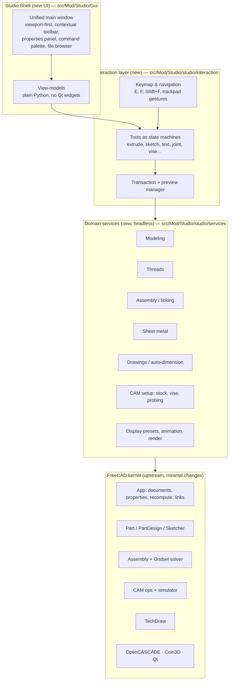

# Development Plan

How we turn FreeCAD into a fast, local, single-environment CAD/CAM app with a clean UI. The
feature gap analysis lives in the [README](../README.md#feature-roadmap); this document says
**how** and **in what order** we build it.

> Working codename for our code: **Studio** (`src/Mod/Studio`). Rename once the product has a name.

---

## 1. Ground rules

### 1.1 Test-driven development

Every change follows **red → green → refactor**:

1. **Red** — write a test that describes the behavior and fails for the right reason.
2. **Green** — write the smallest code that makes it pass.
3. **Refactor** — clean up with the tests still green.

A feature is **done** when:

- [ ] Domain behavior is covered by headless tests (no GUI needed).
- [ ] Interaction (tool/keyboard/mouse logic) is covered by synthetic-event tests.
- [ ] UI has at least a smoke test (it opens, binds, closes cleanly).
- [ ] Visual changes have a reviewed snapshot baseline in `tests/visual`.
- [ ] Performance budgets still pass (see §1.3).
- [ ] Existing FreeCAD tests are no worse than the recorded baseline.
- [ ] A human has used the feature in the running app.

Tests are never weakened to make them pass: no loosened tolerances, skipped cases or
regenerated snapshots without a stated reason (same rule as
[FreeCAD's testing guide](../contrib/guidelines/testing-and-validation.md)).

### 1.2 Test pyramid

| Layer | Framework | Runs with | Speed | Share |
|---|---|---|---|---|
| Domain services (Python) | `unittest` | `FreeCADCmd -t Studio` (headless) | ms | most tests |
| Core / hot paths (C++) | GoogleTest | `ctest -R Studio` | ms | where C++ is used |
| Interaction (tools, keymaps, nav) | `unittest` / GoogleTest with synthetic events | headless | ms | many |
| UI view-models | `unittest` | headless | ms | many |
| UI widgets | `QTest` smoke tests | `FreeCAD -t StudioGui` | s | few |
| Visual | snapshot baselines | `tests/visual` | s | few, key screens |
| Performance | benchmark scripts with budgets | `tools/bench` | s–min | startup, load, sim |

### 1.3 Performance budgets

"Fast and lightweight" is a requirement, so we measure it. Phase 1 records the baseline on the
reference laptop (Ryzen AI 7 445, 16 GB RAM); each later phase must stay within budget:

| Metric | Budget (set after baseline) |
|---|---|
| Cold start to usable window | baseline → target ≤ 50% of baseline by end of Phase 2 |
| Idle memory after start | baseline → must not grow phase-over-phase without sign-off |
| Open reference model (STEP + native) | baseline |
| Full CAM simulation of reference job | baseline (Phase 8) |

### 1.4 Staying mergeable with upstream

We want FreeCAD's kernel and bug fixes for years, so:

- **New behavior goes in our own module** (`src/Mod/Studio`), not scattered through FreeCAD files.
- **Core edits are minimal, isolated and logged** in [`docs/CORE_PATCHES.md`](CORE_PATCHES.md) (file, reason, owner).
  Prefer FreeCAD's extension points (`WorkbenchManipulator`, navigation-style registration,
  command registration, preference pages, overlays) over editing core.
- **Monthly upstream merge** (`git fetch upstream && git merge upstream/main`) on a branch,
  full test run, then merge to `main`.
- License stays **LGPL-2.1-or-later**; anything ported from addons gets a license check first.

### 1.5 Decisions are written down

Architecture decisions go in `docs/adr/NNNN-title.md` (context → decision → consequences).
Phase 1 creates the first ADRs from §2.

---

## 2. System architecture

We keep FreeCAD's **kernel and document model** and replace its **presentation layer**.



### 2.1 Layers and their rules

| Layer | Owns | May depend on | Must not depend on | Tested by |
|---|---|---|---|---|
| **Kernel** (FreeCAD) | Geometry, documents, recompute, persistence, solvers | — | Studio anything | FreeCAD's own suites |
| **Domain services** | "What the user wants" as plain API: `extrude(sketch, 10 mm)`, `add_vise(job)`, `auto_dimension(view, level)` | Kernel App/Part APIs | Qt, Gui, any view | Headless unit tests |
| **Interaction** | Tool state machines, keymaps, navigation, preview and undo transactions | Services; abstract `ViewPort` / `Preview` interfaces | Concrete Qt widgets | Synthetic events |
| **View-models** | UI state: which panel, which fields, enabled/disabled, defaults | Interaction, services | Qt widgets | Headless unit tests |
| **Shell (widgets)** | Drawing the UI, binding to view-models | View-models, FreeCAD Gui | Domain logic | QTest smoke and visual |

Dependencies point **down only**. That one rule keeps almost everything testable without a
window and keeps our code separate from FreeCAD's so upstream merges stay cheap.

### 2.2 Key design choices

- **One environment.** A single always-active Studio workbench gathers the commands from Part Design,
  Sketcher, Assembly, TechDraw and CAM. Tools show up based on **selection and context**,
  not on which workbench you picked. FreeCAD's workbench switcher is hidden, not deleted.
- **Tools are modal state machines** (Blender-style operators): `start → preview → (adjust)* →
  commit | cancel`. Each tool runs inside one document transaction, so cancel and undo are always clean.
- **Python first, C++ for hot paths.** Services, tools and UI are written in Python (with PySide) for speed
  of iteration. Navigation, CAM simulation, rendering and anything profiled as slow go in C++.
- **Lazy loading.** Modules are imported the first time a tool needs them, not at startup.
- **Preferences in one place.** A typed settings service backs "right-click → Make default" on any
  field, using FreeCAD's parameter store underneath.
- **Local only.** No network calls except explicit, user-started actions (update check, part
  download). A test checks this by failing if a socket opens during the test suite.

### 2.3 Repository layout (new parts)

```
src/Mod/Studio/
  CMakeLists.txt
  Init.py / InitGui.py          # registers workbench + test suites
  TestStudioApp.py              # headless suite entry:  FreeCADCmd -t TestStudioApp
  TestStudioGui.py              # GUI suite entry:       FreeCAD -t TestStudioGui
  branding/branding.xml         # product config (start workbench, name, nav style…), copied to bin/
  studio/
    services/                   # headless domain services
    interaction/                # tools, keymap, navigation, transactions
    viewmodels/                 # UI state, no widgets
    settings.py                 # typed preferences + "make default"
  Gui/                          # Qt widgets, resources, icons, .ui files
  App/                          # C++ (only when needed)
  StudioTests/                  # FreeCAD convention <Module>Tests (a bare "tests" package would clash)
    support.py                  # shared helpers, e.g. no_network() guard
    test_architecture.py        # enforces the layer rules automatically
    gui/                        # tests that need FreeCAD.exe
tests/src/Mod/Studio/           # GoogleTest suites for C++ parts
tools/bench/                    # performance benchmarks + budgets
docs/
  PLAN.md  CORE_PATCHES.md  adr/
```

---

## 3. Phases

Each phase ends with a working app, green tests, and budgets checked. Phases 3–9 can be
reordered by priority; Phases 1–2 come first because everything else sits on top of them.

### Phase 1 — Foundation *(current)*

**Goal:** build FreeCAD from source on this PC with one command, record a baseline, and scaffold
our module with TDD and CI in place.

| # | Task | Done when |
|---|---|---|
| 1.1 ✅ | Install toolchain: Visual Studio 2022 Build Tools (C++), pixi; init submodules (see [ADR 0003](adr/0003-native-windows-dev-environment.md)) | `pixi run configure` succeeds |
| 1.2 ✅ | Baseline build (RelWithDebInfo, parallelism capped for 16 GB RAM) | FreeCAD launches from our build |
| 1.3 ✅ | Baseline tests: run `ctest` and the headless suites, record results in [`docs/BASELINE.md`](BASELINE.md). Added `tools/test/run_headless_suites.py` (isolated profile, per-test watchdog) | Known upstream failures listed, so they're never mistaken for ours |
| 1.4 🟡 | Benchmark harness in `tools/bench`: cold start ✅, idle memory ✅, open reference files | Baseline numbers recorded; budgets set in §1.3 |
| 1.5 | **Slim build** preset: turn off FEM, BIM, Robot, OpenSCAD, Points, ReverseEngineering, Inspection, Web, JtReader, AddonManager (verify dependencies one module at a time) | Slim build launches, tests no worse than baseline, startup and memory measured |
| 1.6 ✅ | Scaffold `src/Mod/Studio` (layout from §2.3), registered with CMake and the test runner | `FreeCADCmd -t TestStudioApp` runs a real (initially failing → passing) test |
| 1.7 ✅ | **Walking skeleton (TDD):** Studio workbench exists, is the default at startup (via [branding.xml](adr/0004-branding-via-branding-xml.md)), shows an empty shell; layer-rule tests; local-only socket guard test; end-to-end `tools/test/startup_smoke.py` | Tests written first; all green |
| 1.8 🟡 | CI for our fork: replace upstream's heavy workflows (they trigger on our pushes) with a lean Windows build + Studio tests; full suite nightly or on demand. Upstream workflows + Dependabot removed, `studio-ci.yml` + `tools/repo_tests` added ([ADR 0005](adr/0005-own-ci-workflow.md)) ✅; first green run on GitHub pending | CI green on `main` |
| 1.9 🟡 | Repo docs: our own `AGENTS.md`/`CLAUDE.md` (TDD rules, layers, upstream rules) ✅, ADR template + first ADRs ✅, `CORE_PATCHES.md` ✅, upstream-merge procedure | Docs merged; a practice upstream merge has been done once |

**Exit:** one-command build, baseline and budgets recorded, Studio module green in CI.

### Phase 2 — The Shell (clean, unified UI)

**Goal:** the app *feels* different: sparse, viewport-first, one environment, laptop-friendly.

- Unified main window: workbench switcher hidden, contextual toolbar driven by selection, one
  properties panel, collapsible model tree.
- Command palette (search every command by name).
- Keymap service: `E` extrude, `F` focus selection, `Shift+F` fit all, plus user-editable bindings.
- New default **navigation style**: trackpad pinch zoom and two-finger orbit, plus mouse (builds on FreeCAD's
  existing gesture and pinch support and its tests).
- **File browser** replacing the Start page: recent files with thumbnails; remove or hide entries.
- Settings service with **right-click → Make default** on fields.
- **Lazy module loading** to hit the startup budget.

*Tests first:* keymap resolution, palette search ranking, nav gesture → camera math, recent-files
store, settings defaults (all headless); QTest smoke for the window; visual baselines of the
main screens.

### Phase 3 — Modeling UX

- Direct-manipulation tools: sketch → `E` → drag handle to extrude (wrapping PartDesign Pad/Pocket).
- One-click **section view** with a draggable plane.
- **Display presets:** pretty (shadows), gray box, realistic, hidden line; perspective/ortho toggle.
- **Threads:** cosmetic by default, "model all threads on export", **allowance scrubber**
  (works on cosmetic and modeled), one-click hole chamfer.

*Tests first:* extrude tool state machine (start/preview/commit/cancel/undo); thread service
(cosmetic ↔ modeled volume checks, allowance changes diameter); export-with-modeled-threads round trip.

### Phase 4 — Advanced sketching

- **Text tool:** text box / area / centered area, any installed font, **fonts embedded in the file**.
- **Sketch on curved surfaces:** sketch maps onto and wraps around faces; text on surfaces; extrude in or out.
- **3D spline sketches:** draggable nodes, extend by adding points, automatic sweep for wires, cables and tubing.

*Tests first:* font embedding survives save → reopen on a machine without the font; surface mapping
keeps arc length on cylinders; spline node edits update the sweep with a valid solid.

### Phase 5 — Parts & assemblies in one environment

- No part-vs-assembly split: adding a part to a body makes it an assembly.
- Joints (incl. ball/spherical) usable in place; drag to move with the solver live.
- Import as **clone or link**; detect when a linked file changed ("out of sync — reimport?") while
  keeping local adjustments.
- Exploded views.

*Tests first:* link change detection; reimport keeps placement overrides; joint solver
results for each joint type.

### Phase 6 — Sheet metal (built in)

- License-check, then port or rebuild sheet-metal features as a Studio service.
- Animated unfold, movable fold lines, automatic seam relief cutouts, flat pattern export (DXF).

*Tests first:* unfold area equals folded developed area within bend allowance; relief cuts
generated per seam; DXF output parses.

### Phase 7 — Drawings

- **One-click drawing:** choose views, auto scale and layout to fit the sheet.
- **Auto-dimensioning** levels: None / Basic / Thorough.
- Flat-pattern view for sheet metal; stays live-linked (TechDraw underneath).

*Tests first:* layout never overlaps views; scale picks largest standard scale that fits;
"Basic" dimensions fully define a reference part's overall size.

### Phase 8 — CAM mode

- CAM is a **mode on a body** (badge icon), not a separate workbench.
- Auto stock by default; **one-click vise** (jaw width, opening, parallel height, saved defaults).
- Multi-setup with a **"flip part this way"** animation; the result simulated so far is overlaid on the next setup.
- **Probing wizard** (all sides, pick feature/bore, collision-aware, draggable points; Tormach first).
- **Faster simulation** with "accuracy" (unmachined stock highlighted) and realistic-material views.

*Tests first:* vise placement from part bounding box; probe moves never intersect vise or part;
simulation removed-volume matches reference; G-code golden files per post-processor.

### Phase 9 — Visualization

- Animation studio (timeline, auto-explode, camera moves).
- Built-in path-traced renderer with studio environments; feeds the animation studio.

*Tests first:* timeline interpolation; explode offsets; renderer tested against reference images within a stated perceptual tolerance.

### Phase 10 — Distribution & interop

- Windows installer (then macOS/Linux); explicit "check for updates" (the only background network call, opt-in).
- **Code signing** for release binaries, so Windows Smart App Control / SmartScreen don't block the app for users.
- Optional, user-started **parts library** download with material detection (legal review of
  catalog terms first).
- Long term: feature-history import from other CAD formats.

---

## 4. Risks

| Risk | Mitigation |
|---|---|
| Upstream merges get painful | Our code in our module; core patches logged and minimal; merge monthly |
| FreeCAD build is heavy on 16 GB RAM | Capped parallel jobs; slim build; ccache/sccache |
| UI rewrite stalls on edge cases | Phase 2 ships a shell *on top of* existing commands first, then replaces them one by one |
| Startup budget missed | Benchmarks run in CI; lazy loading lands in Phase 2 |
| Porting addon code with incompatible license | License check before any port |
| GitHub Actions minutes (Windows runners cost 2× if the repo goes private) | Lean per-push CI; full suite nightly or manual |
